# TorBox for Android

A native Android client for [TorBox](https://torbox.app), written from scratch in Kotlin and Jetpack Compose.
It covers everything the TorBox website does — torrents, usenet, web downloads, search, RSS, cloud uploads,
notifications and your account — with a calm, editorial interface designed for one-handed use.

<p>
  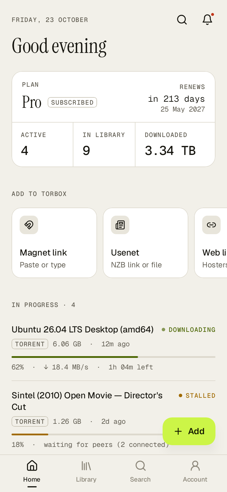
  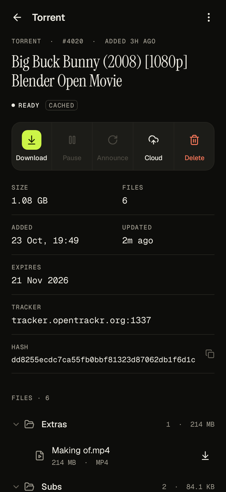
  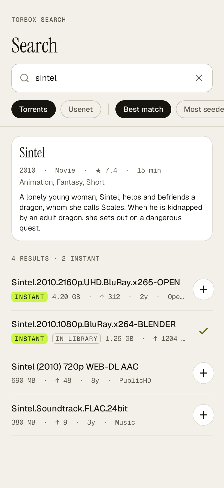
</p>

## Features

**Library**
- Torrents, usenet and web downloads in one place, with live progress, speeds, ETA, seeds/peers and ratio
- Filter (active, ready, seeding, issues), sort, and search by name or hash
- Long-press to select several downloads and delete them together
- Pull to refresh; active downloads refresh on their own while the app is open (3–30 s, configurable)

**A download's page**
- Full file tree with folders, sizes and file types
- Per file: save to the phone (Android's download manager), stream in VLC/MX Player/mpv, copy or share a link
- Whole download as a zip
- Pause, resume and reannounce torrents; pause and resume usenet; delete anything
- Copy the hash or magnet, save the `.torrent` file, copy or share the original link
- Send a file, or the whole download, to Google Drive, OneDrive, Dropbox, GoFile, 1fichier or Pixeldrain

**Adding**
- Magnet links, info hashes and `.torrent` files; NZB links and `.nzb` files; any web or hoster link
- Several at once, one per line
- Live cache check: see whether TorBox already has it before you add it
- Seeding preference, zipping, post-processing level, archive passwords, add-to-queue
- Share a link or magnet into the app from any browser, or open `.torrent`/`.nzb` files with it

**Everything else**
- **Search** TorBox's torrent and usenet indexers, with posters and metadata, instant (cached) and in-library markers
- **Queued** downloads: start now or remove
- **RSS feeds** (Pro): create, edit, pause, resume, check now, delete, and browse scraped items
- **Cloud uploads**: connect accounts and follow upload jobs with live progress
- **Notifications** from TorBox, with clear, clear-all and test
- **Account**: plan, renewal, totals, referral code (copy/share), redeem a referral
- **Supported hosts** with status and daily limits, **service status** with network statistics and a live
  **download speed test** against TorBox's CDN, and the **changelog**
- Optional background alerts when a download finishes
- Light, dark or system theme; looping animations stop when Android's "Remove animations" is on

## Design

The app is built on a small, deliberate design system rather than stock Material:

- **Ink & Signal palette**: warm paper neutrals and a near-black ink, with a single chartreuse "signal" colour
  reserved for things that are live or need attention.
- **Three typefaces**: Instrument Serif for titles and moments, Geist for reading, and Geist Mono with tabular
  figures for every size, speed, hash and timestamp, so numbers never jitter while they update.
- **Lucide** stroke icons, hairline dividers instead of heavy cards, and typographic empty states instead of clip-art.

Every screen is rendered in light and dark on each CI run; see [`docs/screenshots`](docs/screenshots).

| | | |
| --- | --- | --- |
| 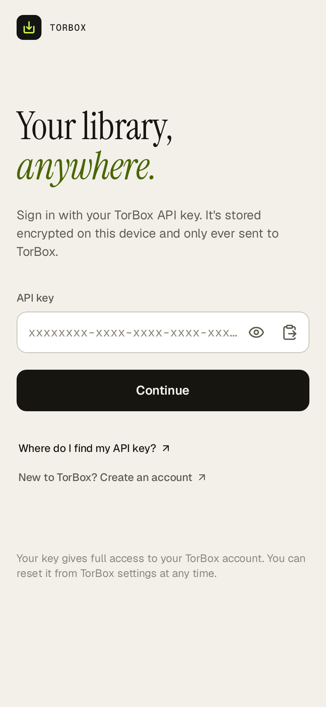 | 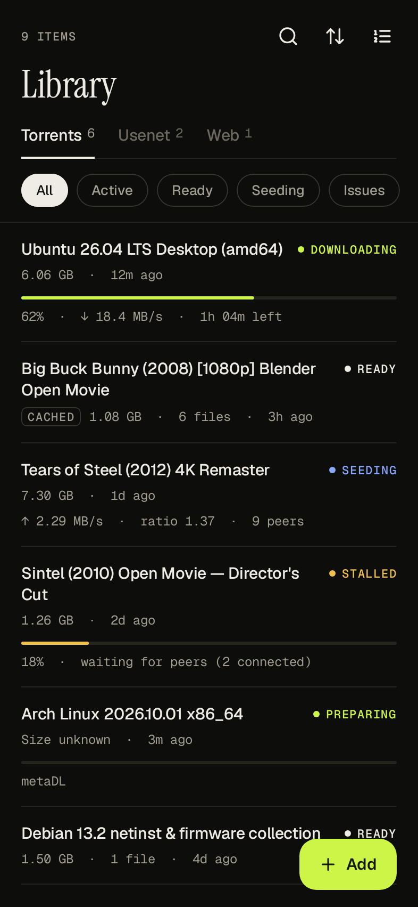 | 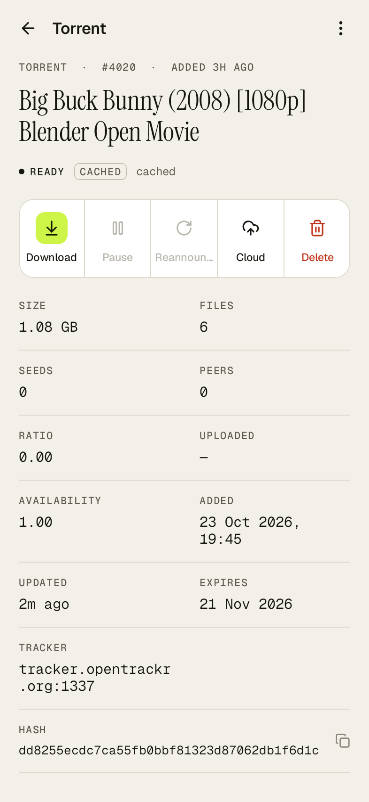 |
| 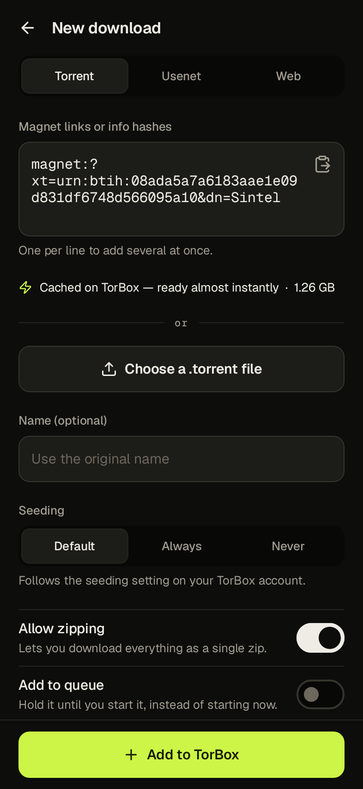 | 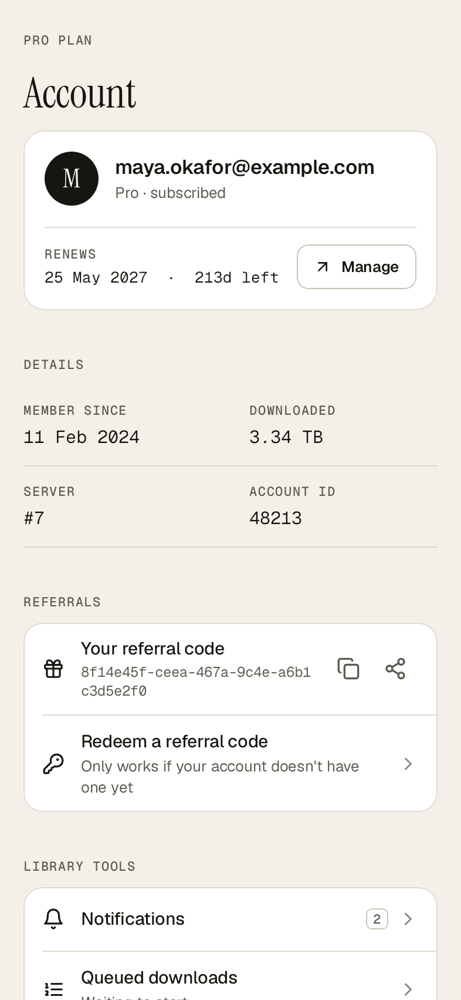 | 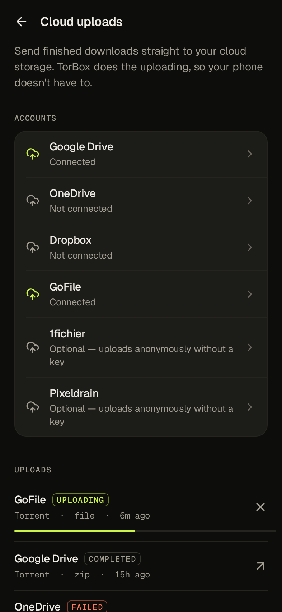 |
| 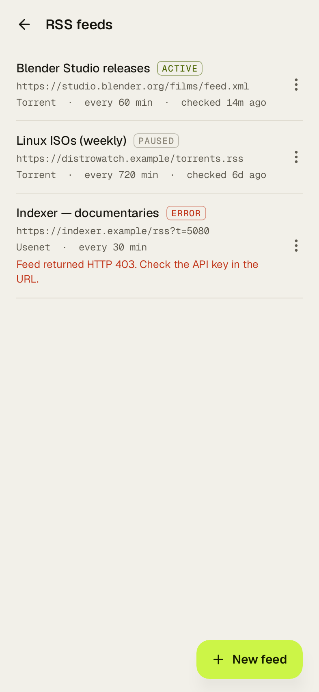 | 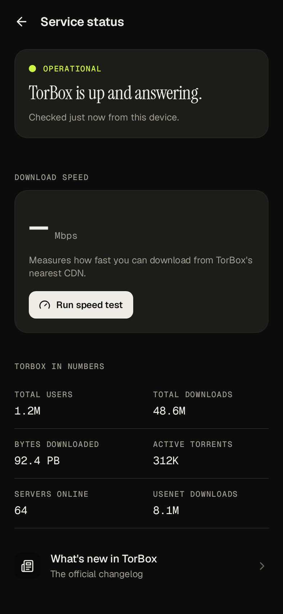 | 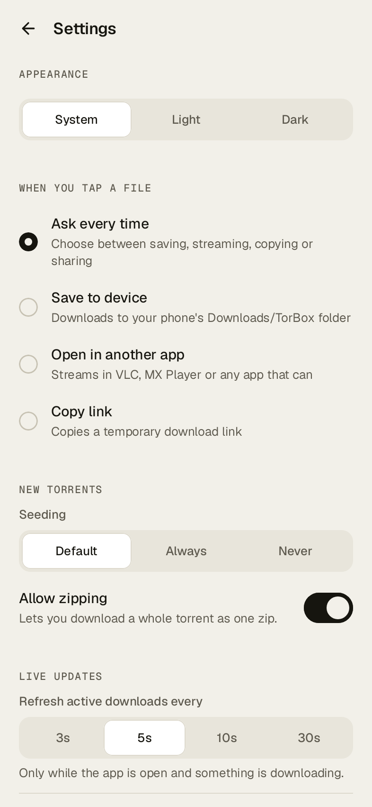 |

## Getting started

1. Install the APK from the latest CI run (Actions → Android CI → `apks` artifact), or build it yourself (below).
2. Open the app and paste your API key from [torbox.app/settings](https://torbox.app/settings).

The key is encrypted with an Android Keystore key and only ever sent to TorBox.

## Building

Requirements: JDK 17+ and the Android SDK (platform 36). Then:

```sh
./gradlew :app:assembleDebug        # app/build/outputs/apk/debug/
./gradlew :core:test                # API client unit tests
./gradlew :app:recordRoborazziDebug # app tests: logic, an end-to-end smoke test against a fake
                                    # TorBox server, and every screen re-rendered into docs/screenshots
```

The release build is minified and, for convenience, signed with the debug key. Configure your own signing
before distributing it.

## Project layout

| Module | What's in it |
| --- | --- |
| `core` | Pure Kotlin: the TorBox API client (OkHttp + kotlinx.serialization), tolerant wire models, domain mapping, formatting. No Android dependencies, fully unit-tested. |
| `app` | Compose UI, view models, encrypted settings, the background completion worker, and intent handling. |

The client targets the TorBox Main API (`api.torbox.app/v1/api`) and Search API (`search-api.torbox.app`), as
documented at [api-docs.torbox.app](https://api-docs.torbox.app).
